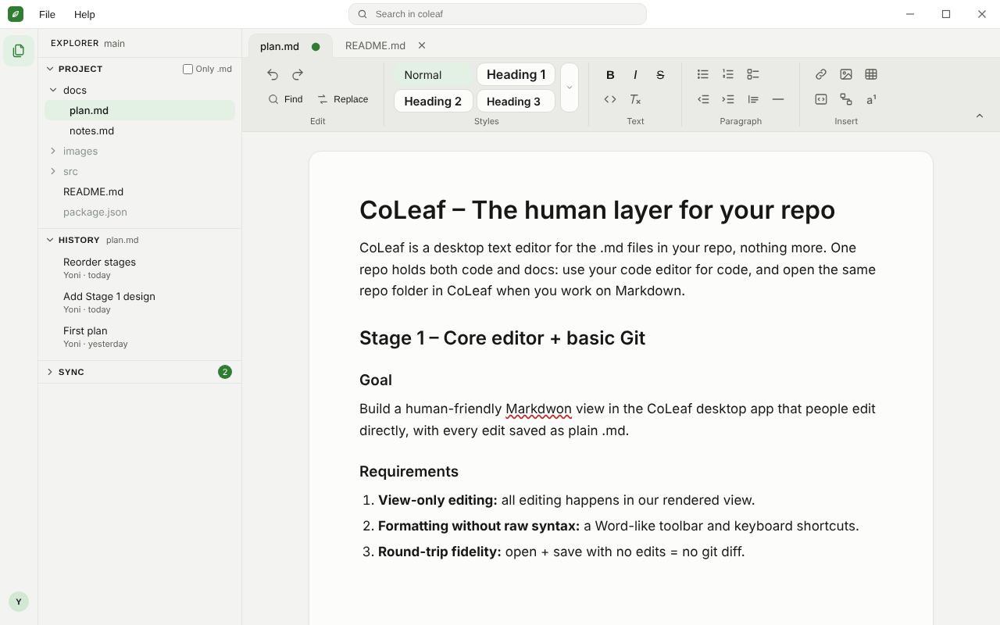

# CoLeaf

**All the power of a repo. None of the nerd.**

CoLeaf is a desktop app for editing the Markdown (`.md`) files in a Git repo like a Word document. Changes stay plain Markdown, Sync with GitHub in one click, and show as readable highlights instead of raw text. Built for people who'd rather not touch code, working solo or as a team, with AI working from the same repo (later stage).

## Status

Planning done. Now building **Stage 1a: prove the core** (open a repo, edit, save with no unwanted git diff).

## Docs

| Doc | What's in it |
| --- | --- |
| [docs/plan.md](docs/plan.md) | What we build, stage by stage |
| [docs/architecture.md](docs/architecture.md) | How it's built: software, structure, repo layout |
| [docs/ui/](docs/ui/) | UI mockups |
| [AGENTS.md](AGENTS.md) | Rules for AI coding agents working in this repo |

## Stack

Electron, React + TypeScript, TipTap (ProseMirror), remark, Mermaid, jsdiff, dugite (bundled Git), GitHub App + Octokit.

## UI preview

