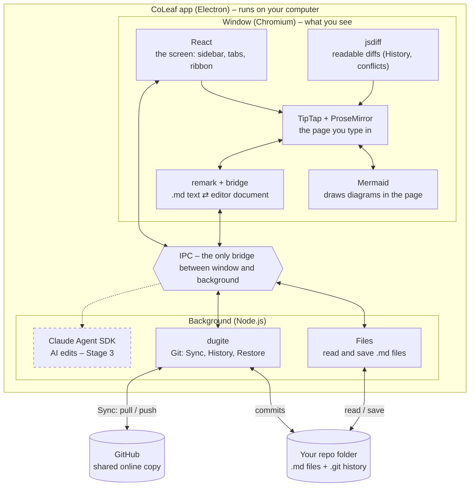

# CoLeaf – Architecture

Oct 15, 2026 · @Yehonatan

CoLeaf is a desktop app that lets anyone edit the `.md` files in a Git repo like a Word document, with simple sync and history. This doc explains how it is built: the software it runs on, what each part does, and how the parts work together.

## Project structure

CoLeaf is one Electron app with two sides: a window the user sees, and a hidden background that handles disk, Git and AI. The two talk through messages (IPC). Tool picks are confirmed for Stage 1.



| Stage | Software | What it does |
| --- | --- | --- |
| **Stage 1** | Electron | The app shell: one window + one background process |
|  | Node.js | The background: reads/saves files, runs Git |
|  | React | Draws the screen: sidebar, tabs, ribbon, dialogs |
|  | TipTap + ProseMirror | The page you type in |
|  | remark (+ remark-gfm, remark-prosemirror bridge) | Turns .md text into the editor document and back |
|  | Mermaid | Draws diagrams from Mermaid text |
|  | jsdiff | Finds changes for History and conflicts (shown as TipTap highlights) |
|  | dugite | Bundled Git: Sync, History, Restore |
|  | GitHub App + Octokit | Sign in to GitHub, clone, push |
| **Release 1** | electron-builder | Builds the installers |
|  | electron-updater | Auto-update |
|  | Sentry | Crash reports |
| **Stage 2** | Octokit (PRs) | Review, comments, branches |
| **Stage 3** | Claude Agent SDK | AI edits |

### How it works

1. **Open:** the background reads the `.md` file and sends it over IPC; remark turns it into a document tree, keeping each block's original text; TipTap shows it.
2. **Edit:** you type; TipTap (through ProseMirror) records which blocks changed.
3. **Save:** an untouched file is never rewritten. An edited file is saved in one consistent Markdown style (keeping unedited parts byte-for-byte comes in Stage 5). The background writes the file. Open + save with no edits = no git diff.
4. **Sync:** the background runs pull, commit and push with dugite.
5. **AI (Stage 3):** the background calls Claude; its edits come back as red/green changes to accept or reject.

## Repo layout

The repo follows the standard electron-vite layout: three code folders that match the two halves of the app, plus the safe bridge between them. Each stage below only adds folders inside this base.

```text
coleaf/
├─ AGENTS.md            rules for any AI agent (tool-neutral)
├─ README.md            short intro
├─ docs/                plan.md, architecture.md, ui/ mockups (exported from our docs)
├─ src/
│  ├─ main/             background (Node.js): disk, Git, later AI
│  ├─ preload/          the safe bridge: the only way window ↔ background talk
│  └─ renderer/         the window (React): everything you see
├─ tests/               automatic checks
├─ .claude/             Claude Code hooks, skills, rules
├─ package.json         libraries and scripts (dev, test, build)
├─ electron.vite.config.ts
└─ electron-builder.yml installer settings
```

## Stage 1 – Core editor + basic Git

Stage 1 builds the whole app frame plus open, edit, save and Sync; it is by far the biggest stage.

| Area | What gets built | Parts used |
| --- | --- | --- |
| Frame | Menu, left icon bar, sidebar, tabs, side-by-side, settings, account | React, Electron APIs |
| Editor | Ribbon, outline, spell check, pictures, and "edit code" blocks for what GitHub renders: Mermaid, HTML (sanitized), math | TipTap v3, Mermaid, Electron spellchecker; to approve: KaTeX, a safe HTML sanitizer |
| Markdown | Open: `.md` → document; save: never rewrite untouched files, one consistent style for edited ones | remark + remark-gfm, remark-prosemirror bridge |
| Git | Sync (commit → pull → push), History, Restore, friendly conflicts | dugite (bundled Git), jsdiff for diffs shown on the formatted page |
| Sign-in | "Sign in with GitHub"; token kept in the OS keychain | GitHub App + device flow, Octokit, Electron safeStorage |
| Quality | Round-trip, Git and app tests run automatically | Vitest, fast-check, Playwright, GitHub Actions |

```text
src/main/
├─ index.ts            app start, main window
├─ files/              open, save, watch for outside changes, Markdown index of folders, pictures (images/)
├─ git/                Sync, History, Restore, conflicts (dugite)
├─ auth/               GitHub sign-in, token storage
└─ ipc/                message handlers for the window
src/preload/
└─ index.ts            the allowed messages, nothing more
src/renderer/
├─ app/                frame, menus, Welcome tab, settings, account
├─ sidebar/            Project tree, History, Sync sections
├─ tabs/               tabs, unsaved dot, side-by-side panes
├─ editor/             TipTap setup, ribbon, outline, Mermaid/HTML/math blocks, search
├─ markdown/           remark ⇄ editor conversion, save rules
└─ styles/             colors, fonts, spacing (Leaf palette)
tests/
├─ roundtrip/          golden .md files: open + save = no change
├─ git/                temporary repos, fake teammate, conflicts
└─ e2e/                Playwright: open, type, save, sync
```

## Release 1 – First public version

Release 1 adds no features; it makes Stage 1 installable, trusted and self-updating.

| Area | What gets built | Parts used |
| --- | --- | --- |
| Installers | Windows and macOS installers, signed (macOS notarized) | electron-builder, Apple Developer Program, Windows code-signing certificate |
| Updates | New versions install themselves | electron-updater (GitHub Releases or cloud storage) |
| Crash reports | Errors reach us | @sentry/electron |
| Build pipeline | Every tag builds all installers automatically | GitHub Actions |

```text
src/main/
├─ updates/            check, download, install updates
└─ crash/              crash reporting setup
build/                 app icons, signing settings
.github/workflows/     tests on every push, installers on every release
```

## Stage 2 – Co-Work

Stage 2 turns Git branches and GitHub review requests into Word-like teamwork; where comments are stored is still to decide.

| Area | What gets built | Parts used |
| --- | --- | --- |
| Branches | Create, switch, merge; a Branches view drawn as a tree | dugite, a graph drawing library (TBD) |
| Review | "Submit for review" opens a review request; "Approve" merges it | GitHub pull requests via Octokit |
| Comments | Word-like sidebar, @mentions, threads, resolve | Storage TBD: comments branch, file next to the doc, or GitHub review comments |
| Permissions | Owner / edit / comment / view per file | CoLeaf rules + GitHub CODEOWNERS and branch protection |

```text
src/main/
├─ github/             review requests, approvals, permissions (Octokit)
└─ comments/           read and write comment threads
src/renderer/
├─ comments/           comments sidebar, anchors in the text
└─ branches/           branch switcher and tree view
```

## Stage 3 – AI

Stage 3 runs Claude in the background half and shows its edits as red/green suggestions you accept or reject.

| Area | What gets built | Parts used |
| --- | --- | --- |
| AI engine | Claude reads the repo's own context (CLAUDE.md, AGENTS.md) and edits files | Claude Agent SDK (native files unpacked from the installer archive) |
| Access | User pastes their own API key, kept in the OS keychain | Electron safeStorage |
| AI panel | Right sidebar chat; chat on a selected paragraph | React |
| Suggestions | AI edits shown red/green; accept, reject or auto mode | TipTap decorations, or TipTap AI Toolkit (trial) |

```text
src/main/
└─ ai/                 Claude Agent SDK sessions, tools, API key
src/renderer/
├─ ai-panel/           right sidebar chat
└─ editor/suggestions/ red/green suggestions, accept/reject
```

## Stage 4 – UI

Stage 4 is polish: no new plumbing, mostly styles and display.

| Area | What gets built | Parts used |
| --- | --- | --- |
| Themes | Dark theme switched in Settings | CSS color tokens |
| Brand | Final logo and name | Installer icons |
| Viewers | Map, 3D model and PlantUML blocks | To approve: a map viewer, a 3D viewer, a PlantUML renderer |

```text
src/renderer/styles/themes/   light.css, dark.css
build/icons/                  final app icons
```

## Stage 5 – Full source preservation

Stage 5 makes saving keep every untouched part of an edited file byte-for-byte; OpenKnowledge shows it is doable (about 30 guard rules), but we can't copy its GPL code.

| Area | What gets built | Parts used |
| --- | --- | --- |
| Save | Keep each block's original text; rewrite only edited blocks | remark positions + our own splice logic |
| Tests | Much larger corpus: CommonMark and GFM spec examples, random edits | Vitest, fast-check |

```text
src/renderer/markdown/preserve/   splice original text for untouched blocks
tests/roundtrip/                  bigger golden corpus + random-edit tests
```

The sections below explain the two core tools in depth.

## Electron

CoLeaf is built on Electron: the same foundation as VS Code, Slack and Obsidian. It lets us build a rich editor with web tools and ship it as a real desktop app.

### What it is

Electron is a free, open-source framework that turns a web app into an installable desktop app. Inside, it carries its own browser engine (Chromium), so the app's screens are built like a website. Users never see a browser: they get a normal app with an icon, its own window and access to files on the computer.

### Components

| Component | What it does | In CoLeaf |
| --- | --- | --- |
| Chromium (window) | Draws the UI from HTML, CSS and JavaScript | Editor, toolbar, file tree |
| Node.js (background) | Runs code with access to the computer | Reads and saves files, runs Git, calls AI |
| Electron APIs | Connect to the operating system | "Open folder" dialog, menus, notifications |
| Packaging | Builds installers, code signing, auto-updates | `.exe` for Windows, `.dmg` for Mac |

### Well-known apps built on Electron

| App | Category |
| --- | --- |
| VS Code | Code editor |
| Cursor | AI code editor |
| Obsidian | Markdown notes |
| Notion | Docs |
| Slack | Team chat |
| Discord | Chat |
| Figma (desktop) | Design |
| Claude (desktop) | AI |

### Alternatives

| Approach | How the screen is drawn | Examples |
| --- | --- | --- |
| Native | The OS's own UI components (Windows: WinUI/WPF, Mac: SwiftUI) | Visual Studio, Apple's apps |
| Cross-platform toolkit | A library draws its own components on every OS (Qt, Flutter) | Telegram Desktop, VLC |
| Web-based: Electron | Its own bundled Chromium | VS Code, Slack, Obsidian |
| Web-based: Tauri | The browser engine already built into the OS; lighter app | Smaller, newer apps |

### Why CoLeaf uses it

- **Best editor tools are web-only:** TipTap and Mermaid run on web technology.
- **Proven in our category:** Obsidian and Notion, the closest products to CoLeaf, are built on it.
- **One codebase** for Windows, Mac and Linux.
- **Full access to the computer:** files, Git and AI run in the Node.js background.
- **Ready packaging:** installers and auto-updates come built in.

**Trade-offs**

- Heavier app: roughly 150 MB to install and more memory than a native app.
- Tauri is lighter, but its background side is written in Rust and its ecosystem is smaller; Electron is the safer choice for a first version.

## TipTap and ProseMirror

TipTap is the editor inside CoLeaf's window: the box the user types in. We build on it instead of writing our own, because the hard part of an editor (cursor, selection, undo, paste, right-to-left text, tables) is already solved there; our product is what we build on top.

### What they are

- **ProseMirror:** the low-level editing engine. It keeps the document as a structured tree and records every change as a small step, which makes undo and red/green diffs possible. Powerful, but needs a lot of code to use.
- **TipTap:** a library built on ProseMirror with a simpler API and ready-made extensions. It is headless: it ships with no look, so every button, color and layout is ours.
- **CoLeaf:** adds the toolbar, the look, the Markdown read/write (remark) and custom blocks such as Mermaid diagrams.

### Options we compared

| Option | What it is | Verdict |
| --- | --- | --- |
| TipTap | Editor on ProseMirror | Chosen: most used (\~15M weekly downloads), mature, MIT |
| Milkdown | Markdown-first, also on ProseMirror | Small community, mostly one maintainer |
| Lexical (Meta) | Separate engine | Not yet 1.0; Nimbalyst uses it |
| BlockNote | Notion-style editor on TipTap | Locks us into its block layout |
| Build our own | From scratch | Years of work |

### License

- The core of TipTap and ProseMirror is open source under MIT: we have the source code, can build on it, and can publish and sell CoLeaf. The only condition is keeping their license notice in the app.
- Versions we already use stay MIT even if they change later; we can keep our own copy (fork).
- Some advanced TipTap features (AI tools, tracked changes) are paid add-ons.

### Who uses them

- **TipTap** (logos on its site): GitLab, LinkedIn, Spotify, Notion, Substack, Datadog, Cursor, Anthropic.
- **ProseMirror** (sponsors): The New York Times, The Guardian, Asana, Box.

Sources: [tiptap.dev](https://tiptap.dev/), [prosemirror.net](https://prosemirror.net/), [editor downloads](https://www.pkgpulse.com/guides/tiptap-vs-lexical-vs-slate-vs-quill-rich-text-editor-2026), [Liveblocks editor comparison](https://liveblocks.io/blog/which-rich-text-editor-framework-should-you-choose-in-2025)
