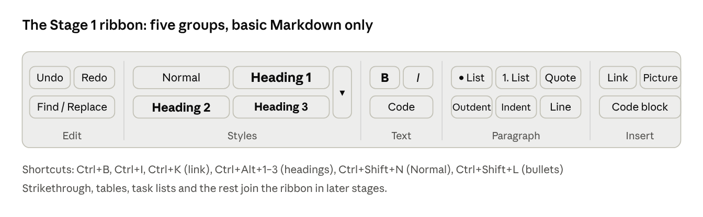
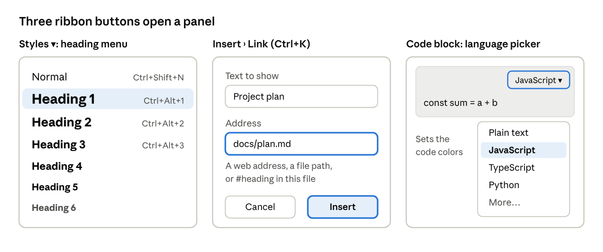

# CoLeaf – Markdown formatting spec

Oct 16, 2026 · Source: CoLeaf – Markdown formatting spec (online doc); this file is now the source of truth.

Every Markdown syntax CoLeaf may meet in a repo. **From Stage 1, CoLeaf shows all of it formatted, like GitHub.** The first column says from which stage each item is editable; Shortcut is decided with the Stage 1 ribbon (Part A).

- **Editable from:** Stage 1 covers only the two CommonMark sections; the rest is Later, or Kept as-is (shown and saved unchanged, never edited as formatting).
- **How:** where it sits in the ribbon (group › button), or "automatic" / "typing" when no button is needed. Filled for Stage 1 only.
- **Shortcut:** its keys, for the Stage 1 features that have one. Ctrl = Cmd on Mac.
- Viewing everything in Stage 1 needs KaTeX (math), a safe HTML renderer, and map and 3D viewers.
- Every row becomes a round-trip test file: open + save must not change it.

Coverage: the full CommonMark 0.31.2 spec, the GitHub Flavored Markdown (GFM) spec, GitHub's extra rendering features, the HTML commonly mixed into Markdown, and popular syntax from other tools that may appear in files written elsewhere.

## Stage 1 ribbon

The ribbon holds only the Stage 1 features from the two CommonMark sections, in the five groups of the UI mockup.





Pictures open the system file picker; HTML blocks and inline HTML get an "Edit code" button on the block itself, not in the ribbon.

## CommonMark: blocks

| Editable from | Feature | Markdown | How | Shortcut |
| --- | --- | --- | --- | --- |
| Stage 1 | Paragraph | Lines of text, separated by a blank line | Styles › Normal | Ctrl+Shift+N |
| Stage 1 | Heading 1–6 (ATX) | `# H1` … `###### H6` | Styles › Heading 1–3 (4–6 in the gallery's ▾) | Ctrl+Alt+1 … 3 |
| Stage 1 | Heading 1–2 (Setext, underlined) | A line of text, then `===` (H1) or `---` (H2) on the next line | Same as headings (saved with `#` once edited) | Ctrl+Alt+1 / 2 |
| Stage 1 | Horizontal rule | `---`, `***` or `___` alone on a line | Paragraph › Horizontal line |  |
| Stage 1 | Block quote | `> quoted text` (nests: `> > deeper`) | Paragraph › Quote |  |
| Stage 1 | Bullet list | `- item`, `* item` or `+ item` | Paragraph › Bullets | Ctrl+Shift+L |
| Stage 1 | Numbered list | `1. item` or `1) item`; may start at any number (`3. item`) | Paragraph › Numbering (start number kept) |  |
| Stage 1 | Nested list | Sub-items indented under the parent item | Paragraph › Increase / Decrease indent | Tab / Shift+Tab |
| Later | Multi-paragraph list item | A blank line, then the next paragraph indented to the item's text |  |  |
| Kept as-is | Tight vs loose list | No blank lines between items (tight) or blank lines (loose, adds spacing) |  |  |
| Stage 1 | Lazy continuation line | A line inside a quote or list item without the `>` or indent still continues the paragraph | Automatic (tidied when the block is edited) |  |
| Stage 1 | Code block (fenced) | Three backticks or tildes before and after, optional language: ```` ```js ```` … ```` ``` ```` | Insert › Code block (language picker on the block) |  |
| Stage 1 | Code block (indented) | Every line indented 4 spaces | Same as code block (saved fenced once edited) |  |
| Stage 1 | HTML block | Raw HTML on its own lines, e.g. `<div>…</div>` | "Edit code" button on the block |  |
| Kept as-is | Link reference definition | `[label]: https://example.com "Title"` (used by reference links) |  |  |
| Stage 1 | Blank lines | Separate blocks; extra blank lines collapse to one | Automatic |  |

## CommonMark: inline

| Editable from | Feature | Markdown | How | Shortcut |
| --- | --- | --- | --- | --- |
| Stage 1 | Italic | `*text*` or `_text_` | Text › Italic | Ctrl+I |
| Stage 1 | Bold | `**text**` or `__text__` | Text › Bold | Ctrl+B |
| Stage 1 | Bold + italic | `***text***` | Text › Bold + Italic |  |
| Stage 1 | Inline code | `` `code` `` (double backticks when the code contains one) | Text › Code |  |
| Stage 1 | Link | `[text](https://example.com "Title")` | Insert › Link (dialog) | Ctrl+K |
| Stage 1 | Link with spaces in the path | `[text](<my file.md>)` (angle brackets) | Automatic |  |
| Stage 1 | Relative link (to another file) | `[Plan](docs/plan.md)`; `/docs/plan.md` starts from the repo root | Insert › Link, type the path; click opens the file | Ctrl+K |
| Stage 1 | Link to a heading | `[Goals](#goals)` or `[Goals](plan.md#goals)` | Insert › Link, type `#heading`; click jumps | Ctrl+K |
| Kept as-is | Reference link | `[text][label]`, `[label][]` or `[label]`, using a definition elsewhere | Its text stays editable |  |
| Stage 1 | Autolink | `<https://example.com>` or `<name@example.com>` | Automatic when typing or pasting a URL |  |
| Stage 1 | Image | `` | Insert › Picture, or paste / drag (saved to `images/`) |  |
| Kept as-is | Reference image | `![alt text][label]` |  |  |
| Stage 1 | Hard line break | Two spaces or a backslash `\` at the end of a line | Typing | Shift+Enter |
| Kept as-is | Soft line break | A plain line break inside a paragraph (shown as a space) |  |  |
| Stage 1 | Escaped character | Backslash before a symbol: `\*not italic\*`, `\#`, `\[` | Automatic (a typed `#` is saved as `\#`) |  |
| Kept as-is | HTML entity | `&amp;`, `&copy;`, `&nbsp;`, `&#169;` |  |  |
| Stage 1 | Inline HTML | Raw tags inside a line, e.g. `<span>`, `<b>` | "Edit code" on the chip |  |

## GFM extensions

| Editable from | Feature | Markdown | How | Shortcut |
| --- | --- | --- | --- | --- |
| Later | Table | Header row and body rows of cells separated by pipes, with a divider row of dashes under the header |  |  |
| Later | Table column alignment | Colons in the divider row: `:---` left, `:---:` center, `---:` right |  |  |
| Later | Formatting inside table cells | Bold, italic, code, links and images work inside cells; a literal pipe is written `\|` |  |  |
| Later | Task list | `- [ ] to do` and `- [x] done`; an item starting with a parenthesis escapes it: `- [ ] \(Optional)` |  |  |
| Later | Strikethrough | `~~text~~` (GitHub also accepts `~text~`) |  |  |
| Later | Extended autolink | Bare `https://example.com`, `www.example.com` or `name@example.com` become links |  |  |
| Kept as-is | Disallowed HTML | `<script>`, `<style>`, `<iframe>`, `<textarea>`, `<title>` and similar are shown as text, never run |  |  |

## GitHub extras

Not part of the GFM spec, but GitHub renders them in `.md` files, so repo files use them.

| Editable from | Feature | Markdown | How | Shortcut |
| --- | --- | --- | --- | --- |
| Later | Footnote | `Text[^1]` plus a definition `[^1]: The note.` anywhere in the file |  |  |
| Later | Alert (callout) | `> [!NOTE]` on the first line of a quote; also `[!TIP]`, `[!IMPORTANT]`, `[!WARNING]`, `[!CAUTION]` |  |  |
| Later | Math, inline | `$E = mc^2$` or ``$`E = mc^2`$``; a literal dollar sign is `\$` |  |  |
| Later | Math, block | `$$` before and after, or a fenced block with language `math` |  |  |
| Later | Mermaid diagram | Fenced code block with language `mermaid` |  |  |
| Later | Map | Fenced code block with language `geojson` or `topojson` |  |  |
| Later | 3D model | Fenced code block with language `stl` |  |  |
| Later | Code syntax highlighting | Language name after the opening fence (`js`, `python`, `diff`…) |  |  |
| Later | Emoji shortcode | `:smile:`, `:+1:` |  |  |
| Later | Front matter | YAML between `---` lines at the very top of the file (GitHub shows it as a table) |  |  |
| Stage 1 | Heading anchors | Every heading gets an automatic id (`## Goals` → `#goals`) that links can target | Automatic |  |
| Kept as-is | Light/dark image | `` and `#gh-light-mode-only` (legacy; GitHub now documents `<picture>`) |  |  |
| Kept as-is | Mentions and issue links | `@user`, `#123`, commit SHAs: linked in issues and PRs, plain text in repo files |  |  |

## HTML used inside Markdown

GitHub allows a safe subset of HTML, so repo files often use it for what Markdown can't do.

| Editable from | Feature | Markdown | How | Shortcut |
| --- | --- | --- | --- | --- |
| Later | Collapsible section | `<details><summary>Title</summary> … </details>` |  |  |
| Later | Underline | `<ins>text</ins>` (GitHub drops `<u>`) |  |  |
| Later | Highlight | `<mark>text</mark>` |  |  |
| Later | Strikethrough (HTML) | `<del>text</del>` or `<s>text</s>` |  |  |
| Later | Subscript / superscript | `H<sub>2</sub>O`, `x<sup>2</sup>` |  |  |
| Later | Keyboard key | `<kbd>Ctrl</kbd>+<kbd>S</kbd>` |  |  |
| Kept as-is | Line break | `<br>` |  |  |
| Later | Image with size or alignment | `` |  |  |
| Later | Light/dark image | `<picture>` with `<source media="(prefers-color-scheme: dark)">` |  |  |
| Later | Figure with caption | `<figure>` + `<figcaption>` |  |  |
| Later | Centered block | `<p align="center">` or `<div align="center">` |  |  |
| Kept as-is | Anchor target | `<a name="section"></a>` (GitHub strips `id`, `class` and `style`) |  |  |
| Later | Comment (hidden) | `<!-- note -->` |  |  |
| Later | HTML table | `<table>` with `<tr>`, `<td colspan>` (merged cells) |  |  |
| Later | Definition list | `<dl><dt>Term</dt><dd>Meaning</dd></dl>` |  |  |
| Later | Other text tags | `<abbr title="…">`, `<small>`, `<q>`, `<cite>`, `<samp>`, `<var>`, `<time>`, `<ruby>`/`<rt>` |  |  |

## Syntax from other tools

Not standard and not rendered by GitHub (it shows them as plain text), but files written in these tools land in repos. CoLeaf must at least keep them unchanged.

| Editable from | Feature | Markdown | How | Shortcut |
| --- | --- | --- | --- | --- |
| Kept as-is | Highlight | `==text==` (Obsidian, Typora, many editors) |  |  |
| Kept as-is | Subscript / superscript (short form) | `H~2~O`, `x^2^` (Pandoc, Typora) |  |  |
| Kept as-is | Wiki link | `[[Page name]]`, with an optional alias after a pipe (Obsidian, Foam, GitLab wikis); must never be escaped to `\[\[` |  |  |
| Kept as-is | Embedded note or image | `![[file]]` (Obsidian) |  |  |
| Kept as-is | Foldable callout | `> [!note]-` and custom callout types (Obsidian) |  |  |
| Kept as-is | Definition list | `Term` then `: Definition` on the next line (Pandoc, PHP Markdown Extra) |  |  |
| Kept as-is | Abbreviation | `*[HTML]: HyperText Markup Language` (PHP Markdown Extra) |  |  |
| Kept as-is | Custom heading id / attributes | `## Goals {#goals}`, `{.class}` (Pandoc, kramdown, Hugo) |  |  |
| Kept as-is | Admonition | `!!! note "Title"` with an indented body (MkDocs) |  |  |
| Kept as-is | Admonition (colon fence) | `:::note` … `:::` (Docusaurus, VitePress) |  |  |
| Kept as-is | Tag | `#tag` inside text (Obsidian) |  |  |
| Kept as-is | Hidden comment | `%% note %%` (Obsidian) |  |  |
| Kept as-is | Table of contents marker | `[TOC]` or `[[_TOC_]]` (GitLab, some editors) |  |  |
| Kept as-is | Generated table of contents | `<!-- toc -->` … `<!-- tocstop -->`, `<!-- START doctoc -->`; markers must never move |  |  |
| Kept as-is | Tool control comments | `<!-- markdownlint-disable -->`, `<!-- prettier-ignore -->`; must never move |  |  |
| Kept as-is | Citation | `[@smith2020]` (Pandoc) |  |  |
| Kept as-is | Template code | `` (Hugo), `` (Jekyll Liquid) |  |  |
| Kept as-is | TOML front matter | Settings between `+++` lines at the top (Hugo) |  |  |
| Later | PlantUML diagram | Fenced code block with language `plantuml` (GitLab, many editors) |  |  |
| — | JSX components | `<Chart data={x} />` in `.mdx` files (MDX); not opened, CoLeaf edits only `.md` |  |  |
